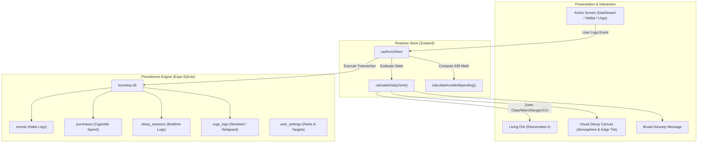
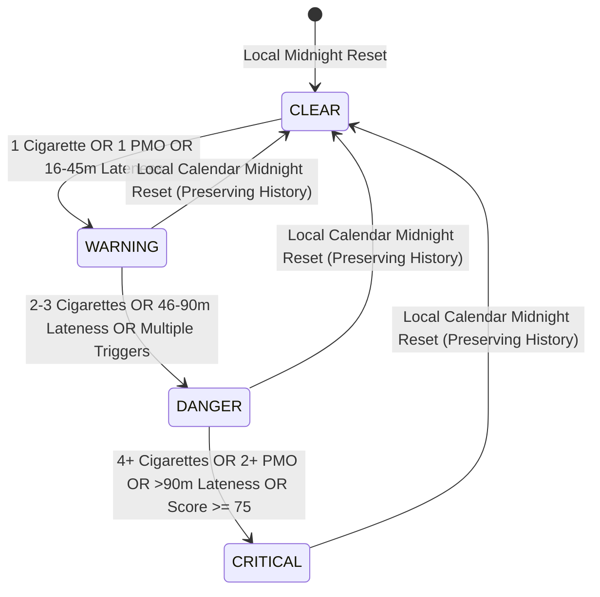

# ARCHITECTURE.md — KuroStop System Architecture

## 1. High-Level System Overview

KuroStop is an offline-first personal discipline system built on Expo and React Native. The core philosophy is **environmental visual consequence**: user actions deterministically alter the visual atmosphere of the application from a pristine mint-accented light canvas to an intimidating corrupted state.



---

## 2. Consequence Engine & Deterministic State Machine

The consequence engine evaluates all recorded actions for the current local calendar date (`YYYY-MM-DD`).

### State Machine Zones



### Deterministic Formula
```typescript
function calculateDailyZone(
  events: HabitEvent[],
  goals: HabitGoals,
  sleepRecord: SleepSession | null,
  nowMinutesPastBedtime: number = 0
): ConsequenceResult
```
- **Smoking Severity**:
  - `0` cigarettes = 0 pts
  - `1` cigarette = 25 pts (WARNING)
  - `2 - 3` cigarettes = 50 pts (DANGER)
  - `4+` cigarettes = 75 pts (CRITICAL)
- **PMO Severity**:
  - `0` episodes = 0 pts
  - `1` episode = 35 pts (WARNING)
  - `2+` episodes = 80 pts (CRITICAL)
- **Sleep Lateness Severity**:
  - `<= 15` min past bedtime = 0 pts
  - `16 - 45` min past bedtime = 20 pts (WARNING)
  - `46 - 90` min past bedtime = 45 pts (DANGER)
  - `> 90` min past bedtime = 75 pts (CRITICAL)
- **Zone Cutoffs**:
  - `0 pts` -> **CLEAR** (`#54C98A` mint glow, slow calm breathing, positive haptic)
  - `1 - 39 pts` -> **WARNING** (`#E9AA40` amber tension, subtle contraction)
  - `40 - 74 pts` -> **DANGER** (`#E76B40` orange flare, asymmetrical pulse)
  - `75+ pts` -> **CRITICAL** (`#D83D52` / `#922539` deep crimson distortion, edge tension)

---

## 3. Financial Calculation Engine

To prevent floating-point inaccuracies, all financial data uses integer Indonesian Rupiah (`IDR`).

```typescript
// 1. Actual Spending
actualSpending = sum(all valid purchase records in time window)

// 2. Baseline Spending
baselineExpectedSpending = dailyBaselineRate * trackedDayCount

// 3. Avoided Spending (Net Savings)
avoidedSpending = baselineExpectedSpending - actualSpending
```

- When `avoidedSpending > 0`: Positive savings achieved against baseline.
- When `avoidedSpending < 0`: User has overspent their baseline (explicitly displayed in red as overspending).
- Labeling honesty: Labeled as *"Perkiraan pengeluaran yang dihindari"* (Estimated avoided spending).

---

## 4. Database Schema (SQLite)

### Table: `user_settings`
- `id` TEXT PRIMARY KEY ('singleton')
- `smoking_target_daily` INTEGER (default 0)
- `pmo_target_daily` INTEGER (default 0)
- `target_bedtime` TEXT (default '23:00')
- `target_wake_time` TEXT (default '06:00')
- `daily_cigarette_spend_baseline` INTEGER (IDR)
- `accountability_intensity` TEXT ('normal' | 'strict' | 'brutal')
- `reduce_motion` INTEGER (0 | 1)
- `onboarding_completed` INTEGER (0 | 1)
- `created_at` TEXT

### Table: `habit_events`
- `id` TEXT PRIMARY KEY (UUID)
- `habit_type` TEXT ('smoking' | 'pmo' | 'sleep')
- `event_timestamp` INTEGER (Unix ms)
- `local_date` TEXT ('YYYY-MM-DD')
- `count` INTEGER
- `pmo_type` TEXT ('pornography' | 'masturbation' | 'combined')
- `trigger_tag` TEXT
- `note` TEXT
- `created_at` TEXT

### Table: `purchases`
- `id` TEXT PRIMARY KEY (UUID)
- `purchase_timestamp` INTEGER (Unix ms)
- `local_date` TEXT ('YYYY-MM-DD')
- `item_type` TEXT ('pack' | 'stick')
- `quantity` INTEGER
- `total_price` INTEGER (IDR integer)
- `brand_name` TEXT
- `note` TEXT
- `created_at` TEXT

### Table: `sleep_sessions`
- `id` TEXT PRIMARY KEY (UUID)
- `sleep_night_date` TEXT ('YYYY-MM-DD')
- `bedtime_timestamp` INTEGER (Unix ms)
- `wake_timestamp` INTEGER (Unix ms, nullable)
- `target_bedtime` TEXT ('HH:mm')
- `lateness_minutes` INTEGER
- `duration_minutes` INTEGER (nullable)
- `created_at` TEXT

### Table: `urge_logs`
- `id` TEXT PRIMARY KEY (UUID)
- `urge_timestamp` INTEGER (Unix ms)
- `local_date` TEXT ('YYYY-MM-DD')
- `habit_type` TEXT ('smoking' | 'pmo' | 'sleep')
- `resisted` INTEGER (1 = resisted, 0 = relapsed)
- `duration_seconds` INTEGER
- `trigger_tag` TEXT
- `note` TEXT
- `created_at` TEXT

---

## 5. Security & Privacy Guarantees
1. **Local-Only Storage**: Zero remote analytics, zero crash telemetry SDKs, zero cloud synchronization by default.
2. **Notification Privacy**: Lock-screen notifications omit explicit PMO terminology (using discreet prompts such as *"Waktunya evaluasi malammu"* instead).
3. **Data Portability**: Full JSON export and one-tap zero-trace database purge.
