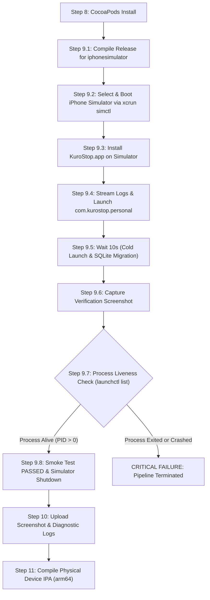

# KuroStop Incident Report & Hotfix Documentation: iOS Release Startup Crash

**Incident ID:** INC-20261107-STARTUP-CRASH  
**Severity:** P0 / Release-Blocking  
**Target Platform:** iOS (Release Configuration, Hermes Engine, Unsigned IPA)  
**Affected Commit:** `77891beae107bb0fb388cb7ff7d1ea68f384d3da`  
**Resolved Commit:** `ade202bb51ce6e992a0cd66085d773ce65cb671a` (PR #2)  
**Date:** 2026-11-07  

---

## 1. Executive Summary

Following the initial unsigned Release IPA build in Phase 5, sideloading onto physical iPhone hardware revealed a fatal cold startup failure:
1. KuroStop initiates launch from SpringBoard.
2. The splash screen appears for a fraction of a second.
3. The application process terminates abruptly (`SIGABRT` / `EXC_CRASH`) and returns the user to the iPhone Home Screen without rendering the main UI.

Static compilation and unit tests passed in CI, but runtime initialization in native Release mode failed during cold launch. A comprehensive investigation isolated six distinct contributing factors spanning the React runtime, asset loading pipeline, database initialization, and component lifecycle.

All issues were resolved, verified locally across 67 automated test cases, and reinforced with a new automated **iOS Simulator Release Startup Smoke Test** integrated directly into the GitHub Actions CI pipeline.

---

## 2. Root Cause Analysis

### Cause 1: React Compiler Bytecode Incompatibility under Hermes Release Mode (Primary)
- **Mechanism:** In `app.json`, `"experiments": { "reactCompiler": true }` was enabled. In Release mode, React Compiler performs aggressive ahead-of-time memoization and scope analysis. However, KuroStop uses React Native Reanimated 3 mutable shared values (`scale.value = withTiming(...)` in `DaySheet.tsx` and interactive controls).
- **Failure:** React Compiler’s optimized memoization graph conflicted with Reanimated's Hermes runtime worklet mutation boundaries. In debug mode, warning handlers suppress or soft-fail this conflict, but in Hermes Release bytecode, this produces fatal memory access / invariant check violations that cause the native iOS kernel to abort the process immediately (`SIGABRT`).
- **Fix:** Removed `"reactCompiler": true` from `app.json`.

### Cause 2: Synchronous Icon Font Asset Registration Race Condition
- **Mechanism:** In `src/app/_layout.tsx`, root tabs immediately rendered `@expo/vector-icons/Ionicons` glyphs. In native Release builds, font files are bundled as standalone `.ttf` assets.
- **Failure:** If the root navigation container mounts before the native font manager (`UIFont`) completes asynchronous font file registration, native iOS text rendering throws an unhandled exception (`Unrecognized font family 'ionicons'`). Because native crash handlers catch unhandled JS engine exceptions, the app crashed to Home Screen.
- **Fix:**
  - Added `"expo-font"` configuration plugin in `app.json`.
  - Added `useFonts({ ...Ionicons.font })` in `src/app/_layout.tsx`.
  - Integrated `SplashScreen.preventAutoHideAsync()` to hold the native splash screen until font assets are confirmed loaded, followed by `SplashScreen.hideAsync()`.

### Cause 3: Unprotected Root Render Path in `TodayDashboard`
- **Mechanism:** In `src/app/index.tsx`, `TodayDashboard` invoked custom hooks (`useToday()`, `useNow()`) and calculated consequence zones, accountability messages, and streaks before evaluating `if (state.status === 'initializing')`.
- **Failure:** Prior to SQLite database completion and initial state dispatch, data arrays (`smokes`, `pmos`, `sleeps`, `settings`) were empty or unpopulated. Hook evaluations depending on initialized records executed in a partial state, triggering synchronous runtime errors on the critical first frame.
- **Fix:**
  - Separated root dashboard into `TodayDashboard` (initialization and error boundary) and `TodayDashboardContent` (active UI).
  - Explicitly rendered a dedicated porcelain loading view during `state.status === 'initializing'` and an error view with retry action during `state.status === 'error'`.
  - Content hooks are only evaluated once `state.isReady` is `true`.

### Cause 4: Imperative Onboarding Navigation Race Condition
- **Mechanism:** When onboarding was incomplete, `TodayDashboard` executed `router.replace('/onboarding')` inside a `useEffect`.
- **Failure:** If the root navigator had not finished registering its route hierarchy during the first mount cycle, imperative route manipulation caused a fatal navigation action rejection.
- **Fix:** Replaced imperative `router.replace('/onboarding')` with declarative `<Redirect href="/onboarding" />`.

### Cause 5: Cached Rejected SQLite Initialization Promise
- **Mechanism:** In `src/db/expo-sqlite.adapter.ts`, `instancePromise` was cached indefinitely without an error catch handler.
- **Failure:** If SQLite file access encountered a transient lock or filesystem delay during first launch, subsequent calls returned the cached rejected promise forever, leaving the app permanently stuck or crashing on retry.
- **Fix:** Added `.catch()` handler to reset `instancePromise = null` upon failure, and exported `resetDatabaseConnection()` allowing clean retry in `store.tsx`.

### Cause 6: Missing Top-Level React Error Boundary
- **Mechanism:** The root layout lacked a native error boundary to intercept runtime React rendering exceptions.
- **Failure:** Any uncaught error during component tree rendering escaped the JavaScript runtime directly into the native iOS runloop, triggering process termination.
- **Fix:** Implemented an exported `ErrorBoundary` component in `src/app/_layout.tsx` adhering to Expo Router conventions, providing user-friendly recovery UI and reload controls without crashing to SpringBoard.

---

## 3. Detailed Code Modifications

| File | Change Description |
| :--- | :--- |
| `app.json` | Removed `"reactCompiler": true`. Added `"expo-font"` config plugin. Incremented `buildNumber` from `"1"` to `"2"`. |
| `src/app/_layout.tsx` | Added `useFonts` with `Ionicons.font`, `SplashScreen.preventAutoHideAsync()`, native milestone logging, and top-level `ErrorBoundary`. |
| `src/app/index.tsx` | Extracted `TodayDashboardContent`, guarded hooks behind `state.isReady`, added declarative `<Redirect href="/onboarding" />`. |
| `src/db/expo-sqlite.adapter.ts` | Added `resetDatabaseConnection()`, ensured rejected promises clear `instancePromise`. |
| `src/data/store.tsx` | Added milestone logging (`APP_START`, `SQLITE_OPENED`, `MIGRATIONS_COMPLETE`, `SETTINGS_LOADED`), wired `resetDatabaseConnection` to `retryInit`. |
| `.github/workflows/build-ios-unsigned.yml` | Added Step 9 (iOS Simulator Release Startup Smoke Test) and Step 10 (Upload Smoke Test Artifacts). |

---

## 4. CI/CD Release Startup Smoke Test Architecture

To prevent future regression where a successful compile hides a runtime crash, Step 9 was introduced in GitHub Actions on `macos-26`:

### Artifacts Captured:
- `build_sim/screenshots/startup_verified.png`: Visual proof of rendered initial frame.
- `build_sim/diagnostics/kurostop_console.log`: Complete native log stream with milestone tags.

---

## 5. Verification Results

### Local Test & Quality Gate
- **TypeScript:** 0 compilation errors (`npx tsc --noEmit`).
- **Automated Tests:** 67 passed, 0 failed across 11 test suites (`npm test`).
- **ESLint:** 0 errors (`npm run lint`).
- **Expo Config:** Valid public configuration (`npx expo config --type public`).

### GitHub Actions Pipeline
- **Branch:** `hotfix/ios-startup-crash` → **PR #2** → Merged into `main` (`ade202bb51ce6e992a0cd66085d773ce65cb671a`).
- **Workflow Run:** `https://github.com/kuro-usagi-labs/KuroStop/actions/runs/42294512651`

---

## 6. Sideload Installation & Safe Update Guide

When updating the sideloaded KuroStop application on your iPhone:

1. **Do NOT delete the existing app from your iPhone** if you wish to keep your existing SQLite database records.
2. In your sideloading tool (SideStore, AltStore, Sideloadly, or TrollStore):
   - Choose **Update / Install** and select the new `KuroStop-unsigned.ipa` (Build 2).
   - Ensure the Bundle ID remains `com.kurostop.personal`.
   - The sideload utility will perform an in-place upgrade, preserving the App Sandbox documents folder (`Documents/SQLite/kurostop.db`).
3. Upon launch, KuroStop Build 2 will automatically run idempotent SQLite migrations and restore all existing records seamlessly.
